<div align="center">
  

  <br/><br/>

  <a href="https://github.com/abubakr-bd">
    
  </a>

  <p align="center">
    <a href="https://github.com/abubakr-bd"></a>
    <a href="mailto:abubakr-bd@users.noreply.github.com"></a>
    
  </p>
</div>

---

## ⚡ About Me

Hey! I'm Abu Bakr Siddiq — a **Motion Designer, Video Editor, and Creative Builder**.

I focus on visual storytelling, motion graphics, and clean UI/UX designs. When building on the web, I keep things practical: using basic web stacks, **vibe coding**, and leveraging AI tools and automations to turn ideas into reality fast.

```javascript
const abuBakr = {
    role: "Motion Designer & Creative Builder",
    software: {
        motion: ["Adobe After Effects"],
        editing: ["Premiere Pro", "DaVinci Resolve"],
        design: ["Figma", "UI/UX Layouts"]
    },
    techAndCode: {
        basics: ["HTML5", "CSS3", "JavaScript"],
        workflow: ["Vibe Coding", "AI Prompts & Tools", "Automations"]
    },
    currentFocus: "Motionly — turning static concepts into fluid motion ✨",
    motto: "Make it move, keep it clean, let AI speed up the build 🚀"
};
```

---

<details open>
<summary><h2>🎬 Creative Workspace & Motion Toolkit</h2></summary>
<br/>

<div align="center">
<table>
  <tr>
    <td width="50%" valign="top">
      <h3>🟣 Adobe After Effects</h3>
      <p>Kinetic typography, motion graphics, visual effects, and fluid animation physics.</p>
      <p>
        
        
      </p>
    </td>
    <td width="50%" valign="top">
      <h3>🔵 Adobe Premiere Pro</h3>
      <p>High-energy pacing, dynamic multi-cam edits, audio syncing, and narrative flow.</p>
      <p>
        
        
      </p>
    </td>
  </tr>
  <tr>
    <td width="50%" valign="top">
      <h3>🟡 DaVinci Resolve</h3>
      <p>Cinematic color grading, curve adjustments, HDR finishing, and Fairlight sound.</p>
      <p>
        
        
      </p>
    </td>
    <td width="50%" valign="top">
      <h3>🎨 Figma &amp; UI/UX</h3>
      <p>Clean layout architecture, wireframing, component design, and interactive prototypes.</p>
      <p>
        
        
      </p>
    </td>
  </tr>
</table>
</div>

<div align="center">
  
  
  
  
</div>

</details>

---

<details open>
<summary><h2>⚡ Vibe Coding, AI &amp; Web Fundamentals</h2></summary>
<br/>

<div align="center">
<table>
  <tr>
    <td width="33%" align="center">
      <h3>🌐 Web Basics</h3>
      <p>HTML5 semantic structure, modern CSS responsive design, and core JavaScript.</p>
      <p>
        
        
        
      </p>
    </td>
    <td width="33%" align="center">
      <h3>✨ Vibe Coding</h3>
      <p>Guiding AI models with strong taste, rapid prototyping, and shipping features smoothly.</p>
      <p>
        
        
      </p>
    </td>
    <td width="33%" align="center">
      <h3>🤖 Automations</h3>
      <p>Prompt workflows, automated scripting, and modern developer toolchains.</p>
      <p>
        
        
      </p>
    </td>
  </tr>
</table>
</div>

</details>

---

<details open>
<summary><h2>🚀 Featured Projects</h2></summary>
<br/>

<div align="center">
<table>
  <tr>
    <td width="50%" valign="top">
      <h3 align="center"><a href="https://github.com/abubakr-bd/motionly-v2">🎬 Motionly v2</a></h3>
      <p align="center">
        
        
      </p>
      <p>Creative web motion platform focused on dynamic visuals, animations, and modern aesthetic UI.</p>
    </td>
    <td width="50%" valign="top">
      <h3 align="center"><a href="https://github.com/abubakr-bd/motionly-media">🎨 Motionly Media</a></h3>
      <p align="center">
        
        
      </p>
      <p>Visual assets, media elements, animation templates, and design resources.</p>
    </td>
  </tr>
</table>
</div>

</details>

---

<details open>
<summary><h2>📊 GitHub Activity &amp; Live Stats</h2></summary>
<br/>

<div align="center">
  
</div>

<br/>

<div align="center">
  
</div>

<br/>

<div align="center">
  
  
</div>

</details>

---

<details>
<summary><h2>🎬 Video Reels &amp; Design Showcase</h2></summary>
<br/>
<div align="center">
  <p><i>Add your demo reels, Behance links, or project highlights here anytime!</i></p>
</div>
</details>

---

<div align="center">
  
</div>
